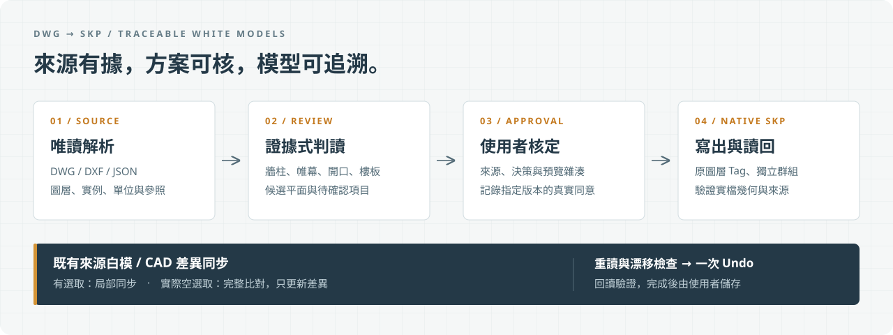
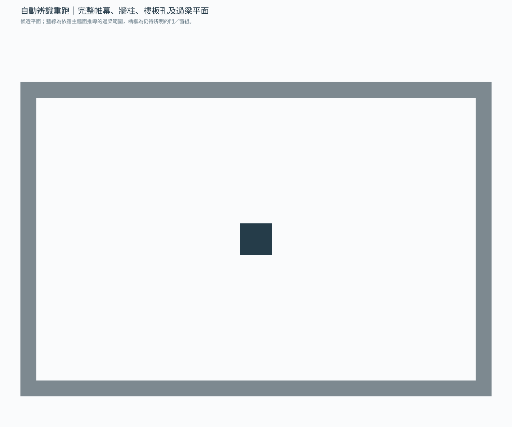

# DWG → SKP White Model

**把建築平面整理成可核定、保留來源圖層、可追溯的 SketchUp 白模。**

Reviewable DWG/DXF to source-layered SketchUp models, with CAD-driven updates to an existing white model.


[快速開始](#quickstart) · [建模流程](#modeling) · [同步流程](#sync) · [架構](docs/ARCHITECTURE.md) · [貢獻指南](CONTRIBUTING.md) · [發布資料](docs/PUBLISHING.md)



建築來圖的圖層、圖塊與標註方式各不相同。這個專案把來源解析、構件判讀、人工核定與原生檔驗證分成明確步驟，讓牆、柱、帷幕、開口與 RC 樓板都有可查的來源與決策。構件可獨立編輯，Tag 保留原 CAD 圖層，構件分類另存於群組與屬性。

目前套件版本為 `0.2.1`，以 **v0.2.1 Pre-release** 提供先行驗證；原生流程以 Windows、本機 AutoCAD 與 SketchUp 為主。

## 目錄

- [功能與使用情境](#features)
- [環境需求](#requirements)
- [快速開始](#quickstart)
- [從平面建立白模](#modeling)
- [同步目前開啟的白模](#sync)
- [輸出與資料追溯](#outputs)
- [固定白模規範](#standard)
- [支援範圍與限制](#limitations)
- [開發與驗證](#development)
- [常見問題](#faq)
- [授權與致謝](#license)

<a id="features"></a>
## 功能與使用情境

| 需求 | 提供的流程 |
|---|---|
| 從新的 DWG／DXF 開始建模 | 唯讀解析 → 圖層及構件盤點 → 預覽與決策 → 使用者核定 → 原生 SKP 寫出及重新讀入驗證 |
| 修正既有白模的一部分 | 讀取 AutoCAD 實際選取，規劃開口、補建、輪廓替換或移除明選錯建，以一次 Undo 更新 |
| 比對整份 CAD 與既有白模 | 確認實際空選取後，完整比對 CAD／SKP，更新支援構件中的新增、修改及刪除，保留未變件 |
| 只檢查分類規則 | 輸入抽取 JSON，輸出分類結果與 Markdown 稽核報告 |
| 追查構件來源 | 保存來源雜湊、完整物件／實例 ID、原始與有效圖層、分類依據及核定版本 |

判讀結合圖層、幾何、圖塊與空間關係。巢狀圖塊的葉件保留各自來源；用途衝突、缺少尺寸或無法證明的構造列入待確認項目。

初次建模使用 [dwg-layered-skp](skills/dwg-layered-skp/SKILL.md)。既有來源白模的局部或整模同步使用 [dwg-skp-sync](skills/dwg-skp-sync/SKILL.md)，兩者共用同一份 Python 核心。

從 v0.2.0 升級時，請使用 v0.2.1 的成對技能包，先更新核心，再更新同步技能；此版修正 GitHub 下載後同步入口的清單雜湊失配。

需要成對技能包時，可前往[下載與安裝說明](downloads/README.md)，並以附帶的 SHA-256 校驗檔核對下載結果。

<a id="requirements"></a>
## 環境需求

| 項目 | 需求與用途 |
|---|---|
| Python | `3.11+` |
| 幾何核心 | `Shapely >=2.0,<3`，由 pip 安裝其相依套件 |
| 檢視圖，選用 | `matplotlib >=3.8`，對應 `review` 額外依賴 |
| DWG／DXF 解析 | 本機 AutoCAD Core Console、相符 .NET SDK／參考組件；目前抽取器目標為 `net8.0-windows` |
| 原生 SKP 寫出與讀回 | 可載入的 SketchUp C API，即 `SketchUpAPI.dll` |
| 即時同步 | 開啟 AutoCAD 與來源綁定的 SketchUp 白模，並載入專用 Ruby 橋接器 |
| 整模即時 CAD 讀取 | 目前使用 Windows AutoCAD 2026 與已安裝的 .NET 8 SDK |

已有抽取 JSON 時可先做解析與判讀，不需執行 AutoCAD。實際 SKP 寫出、讀回及即時同步仍各自需要原生環境。AutoCAD、SketchUp 與其 SDK／執行階段需另外取得，本倉庫不隨附這些商用軟體。

必要時可指定下列環境變數，請換成自己電腦上的實際路徑：

```powershell
$env:DWG_LAYERED_ACCORECONSOLE = "C:/Program Files/Autodesk/AutoCAD 2026/accoreconsole.exe"
$env:SKETCHUP_API_DLL = "C:/Program Files/SketchUp/SketchUp 2021/SketchUpAPI.dll"
```

`DWG_SKP_DEPENDENCIES` 可另外指定 skill 使用的 Python 套件目錄。一般從原始碼安裝時，先使用下列虛擬環境即可。

<a id="quickstart"></a>
## 快速開始

從 GitHub 的 **Code → Download ZIP** 取得原始碼並解壓，或 clone 本倉庫。在專案根目錄開啟 PowerShell：

```powershell
py -3 -m venv .venv
.\.venv\Scripts\python.exe -m pip install -e .

# 需要 PNG 檢查圖時再安裝
.\.venv\Scripts\python.exe -m pip install -e ".[review]"

.\.venv\Scripts\python.exe skills/dwg-layered-skp/scripts/dwg_to_skp.py doctor
.\.venv\Scripts\python.exe skills/dwg-skp-sync/scripts/dwg_skp_sync.py doctor
```

`doctor` 供檢查依賴與路徑；同步入口的 `doctor` 不連線應用程式。橋接器是否已載入要另外執行 `status`。缺少原生依賴時，可先用合成 JSON 範例檢查判讀流程：

```powershell
.\.venv\Scripts\python.exe skills/dwg-layered-skp/scripts/dwg_to_skp.py inspect `
  examples/synthetic-plan.json --job work/demo-001
```

每次執行請使用新的 `--job` 資料夾。開啟 `work/demo-001/recognition.html` 查看候選平面，並閱讀 `review.md` 與 `review.json`。

範例是 6000 × 4000 mm 的合成平面，包含四段牆界與一個柱形輪廓。它刻意保留材料／分類決策與垂直資訊待核，因此預期回傳 **`blocked` 並以非零代碼結束**，同時留下判讀檔案；不會產生 SKP。詳見[範例說明](examples/README.md)。



上圖是平面候選輸出，尚未核定，也不是 SKP 實檔驗證結果。

<a id="modeling"></a>
## 從平面建立白模

以下路徑為範例，請替換成實際來源與新的工作目錄。

### 1. 解析與檢查來源

```powershell
.\.venv\Scripts\python.exe skills/dwg-layered-skp/scripts/dwg_to_skp.py inspect `
  D:/Incoming/plan.dwg --job D:/Models/job-001
```

先讀 `layers.json`、`classification.json`、`recognition.html` 與 `review.md`。來源單位不明時，確認後才補上 `--unit mm`、`cm`、`m` 或 `inch`。外部參照缺漏、未支援物件與解析失敗會保留診斷。

### 2. 完成決策與更新預覽

在工作目錄的 `decisions.json` 補齊材料用途、輪廓、宿主、開口、板域與標高等決策，保留原本的來源雜湊。先提出 RC 樓板判讀：

```powershell
.\.venv\Scripts\python.exe skills/dwg-layered-skp/scripts/dwg_to_skp.py slab-review `
  D:/Models/job-001 --output D:/Models/slab-review-001

# 完成 decisions.json 與 decisions.slabs 後更新整體方案
.\.venv\Scripts\python.exe skills/dwg-layered-skp/scripts/dwg_to_skp.py review D:/Models/job-001
```

`blocked` 須先解決具體缺項；`ready_for_confirmation` 表示方案已可供使用者核定。欄位及覆寫方式見[完整流程](skills/dwg-layered-skp/references/workflow.md)與 [RC 樓板契約](skills/dwg-layered-skp/references/rc-slabs.md)。

### 3. 記錄真實核定並建立 SKP

展示該版本的平面、尺寸、排除項與修補後，取得使用者的明確同意，再記錄其原話：

```powershell
$review = Get-Content D:/Models/job-001/review.json -Raw | ConvertFrom-Json
if ($review.status -ne "ready_for_confirmation") { throw "請先解決 review 的阻擋項目" }
$confirmation = Read-Host "輸入使用者對目前預覽的實際確認原話"

.\.venv\Scripts\python.exe skills/dwg-layered-skp/scripts/dwg_to_skp.py approve `
  D:/Models/job-001 --review-sha256 $review.review_sha256 --confirmation $confirmation

.\.venv\Scripts\python.exe skills/dwg-layered-skp/scripts/dwg_to_skp.py build D:/Models/job-001
```

預設輸出為工作目錄下的 `delivery/model.skp`。交付前須確認 `delivery_qa.json` 的狀態及實檔重新讀入結果。來源、決策或預覽改變時需重新核對；`revise --to <新工作目錄>` 可建立不沿用舊核定的版本。

<a id="sync"></a>
## 同步目前開啟的白模

同步限用本專案生成、保留 `DWG_LAYERED_SKP` 來源屬性的白模，並需要對應工作資料中的 `document.json`。任意手工 SKP 須先另行建立可信來源關係。

```powershell
.\.venv\Scripts\python.exe skills/dwg-skp-sync/scripts/dwg_skp_sync.py status
```

初次部署橋接器時，依[同步契約](skills/dwg-skp-sync/references/sync-contract.md)使用 `install-bridge`；安裝後由使用者重新開啟 SketchUp 載入。日常同步先檢查 `status`。

| AutoCAD 真實狀態 | 行為 |
|---|---|
| 有完整且新鮮的選取 | 局部同步，依明確範圍規劃修改 |
| 完整快照確認為空選取 | 整模差異同步，完整讀取 CAD／SKP |
| 快照缺漏、過期、截斷或讀取失敗 | 停止，重新讀取來源 |

使用技能時可提出：

> `$dwg-skp-sync 同步我目前在 AutoCAD 選取的牆到目前開啟的 SketchUp 白模，保留既有門洞，其他構件不動。`

CLI 的局部規劃範例：`actual-selection.json` 必須來自 AutoCAD 的真實完整 Pickfirst 讀取，並符合契約的新鮮度要求。

```powershell
.\.venv\Scripts\python.exe skills/dwg-skp-sync/scripts/dwg_skp_sync.py plan `
  D:/Models/job-001 --selection-json D:/Models/op-001/actual-selection.json `
  --action replace_from_cad --live-cad-geometry --auto-match-position `
  --output D:/Models/op-001/plan.json
```

核對計畫後，局部模式在套用前重讀選取；整模模式重讀完整 CAD。`apply` 同時檢查來源、參照、計畫雜湊及 SKP 幾何漂移。通過後以單筆 Undo 更新並回讀驗證；失敗會中止該筆交易。無差異的整模驗證回傳 `unchanged`，不新增 Undo。

同步不自動儲存，也不另建 SKP；完成後由使用者儲存目前模型。完整套用命令、收據與失敗處理見[局部同步](skills/dwg-skp-sync/references/live-repair.md)及[整模同步](skills/dwg-skp-sync/references/whole-model-sync.md)。

<a id="outputs"></a>
## 輸出與資料追溯

| 檔案／資料 | 用途 |
|---|---|
| `document.json` | 正規化來源、單位、原始／有效圖層、完整實例 ID 及解析診斷 |
| `layers.json`、`classification.json` | 圖層盤點、構件分類與依據 |
| `recognition.json`、`recognition.html` | 自動平面辨識候選與可切換的檢查圖 |
| `decisions.json` | 本次來源綁定的圖層、構件、樓板與修補決策 |
| `model.plan.json`、`review.*` | 候選幾何、摘要、預覽與版本雜湊 |
| `approval.json` | 對指定預覽版本的使用者核定 |
| `delivery/model.skp`、`delivery_qa.json` | 原生交付與重新讀入檢查 |
| 同步 `plan.json`／`receipt.json` | 當次範圍、變更計畫、驗證結果與交易紀錄 |

每件構件以獨立群組保存，葉群組 Tag 對應來源圖層，原始邊與面使用 Untagged／Layer0。圖塊內 Layer 0 預設採有效圖層，同時保留原始層、插入層及實例路徑。多來源構件保留完整來源清單及核定的主要圖層。

<a id="standard"></a>
## 固定白模規範

以下是本專案採用的建模規範，尺寸依據與來源角色仍需核對：

- RC 樓板採整片、名義等厚的閉合材料殼，保留核定外框及孔界；缺少其他厚度依據時，提出 **200 mm** 白模預設並標示其來源。
- 牆、柱與全高帷幕收到當地實際上方板底，保留原基底、門窗淨空及窗台。缺板底依據時列缺項。
- 樓梯間依實際牆內邊與門檻界線整間挖空，包含平台，並綁定正確作用樓板。
- 防火門與防火捲簾不建立 3D 本體；其 2D 洞口、門檻及分區證據仍參與判讀。
- 同一牆系的外圈扣除內圈形成材料區，保留房間、管井與內腔。輪廓修補須留下來源、容差及材料變化紀錄。

`200 mm` 是白模工作預設，不能據此推定牆厚或把它當成圖面已明示的結構尺寸。個案設定存於外部 profile 或工作決策，不以特定圖面 handle、絕對座標或既有案例數量建立通用補丁。

<a id="limitations"></a>
## 支援範圍與限制

| 範圍 | 目前處理方式 |
|---|---|
| 一般牆、結構牆、柱、帷幕及配件 | 依來源證據提出分類、材料範圍與高度方案 |
| 門窗洞、過梁、窗台 | 需要可確認的完整輪廓、宿主與垂直淨空；門扇掃掠弧不直接當成材料邊界 |
| 水平 RC 樓板、開口及降板 | 依板域、標高與來源綁定決策生成整片殼；整模同步可更新已綁定系統 |
| 局部選取樓板同步 | 尚不支援；局部模式只將樓板用作板底依據 |
| 樓梯本體、設備、斜板、斜屋頂 | 列為參考／待確認，按已驗證能力處理 |
| AEC／代理物件、缺失外部參照 | 保留未支援或缺漏診斷，必要時阻擋 |
| 多份獨立 DWG | 各自建立工作資料夾；不自動推定跨檔樓層與配準 |

模型供白模工作與來源核對使用。自動平面辨識、幾何檢查與原生檔驗證各自有不同用途；構造用途及設計尺寸仍須由來源資料與核定決策支持。

<a id="development"></a>
## 開發與驗證

主要原始碼在 `src/dwg_semantic/`；`skills/dwg-layered-skp/scripts/runtime/` 是供技能使用的發布副本。修改核心後以 `tools/package_skill.py` 更新副本與同步入口的相依雜湊。

```powershell
.\.venv\Scripts\python.exe -m pip install pytest PyYAML
$env:PYTHONPATH = (Resolve-Path src).Path
.\.venv\Scripts\python.exe -m pytest tests -q
```

部分測試需要 Ruby、SketchUp C API 或指定原生環境；請一併檢查 skipped／失敗原因。只跑 `unittest discover` 不會涵蓋所有 pytest 案例。完整測試、打包與安裝順序見[貢獻指南](CONTRIBUTING.md)，本次結果見 [v0.2.1 驗證紀錄](docs/VALIDATION.md)。

完成上述合成範例的 `inspect` 後，可用其正規化文件單獨執行分類稽核：

```powershell
.\.venv\Scripts\python.exe -m dwg_semantic.cli work/demo-001/document.json `
  --rules config/default_rules.json --source-name synthetic-plan.json `
  --output work/classification-demo.json --report work/classification-demo.md
```

| 目錄 | 內容 |
|---|---|
| `src/dwg_semantic/` | 解析、分類、辨識、成模、同步及原生驗證核心 |
| `config/` | 通用規則；個案設定另存外部工作資料 |
| `skills/` | 初次建模／同步技能、啟動器、共用 runtime 與 Ruby 橋接器 |
| `tests/` | 合成回歸、資料契約、CLI 與原生環境檢查 |
| `tools/` | 技能打包、安裝及升級驗證工具 |
| `examples/` | 可公開重跑的合成來源 |
| `downloads/` | 成對技能包、校驗檔與安裝入口 |
| `docs/` | 架構、發布內容及文件圖片 |
| `jobs/`、`outputs/`、`work/` | 本機工作與驗證暫存，不隨公開版本發布 |

<a id="faq"></a>
## 常見問題

**沒有 AutoCAD 可以先試用嗎？** 可以使用隨附的 JSON 做判讀。DWG／DXF 的實際解碼仍需要 AutoCAD Core Console；原生 SKP 需要可用的 SketchUp C API。

**為什麼 inspect 產生了圖，卻顯示 blocked？** 解析與預覽會保留可用資料，讓你處理單位、用途、輪廓、宿主或標高缺項。圖檔存在不代表方案已可核定。

**會把所有圖層都擠出嗎？** 會結合幾何與用途分類；不明項目保持待確認，參考與排除項需有明確理由。

**同步可以更新未儲存的 CAD 變更嗎？** 即時流程可讀取目前 CAD 記憶體幾何，另記 live revision；原始來源、工作文件及核定雜湊仍需通過檢查。來源檔已另存或變更版本時須重新核對。

**同步出錯可以直接重試 apply 嗎？** 先看收據。`receipt_persistence_error` 表示模型可能已提交，須保留結果並檢查現況，不能直接重放。幾何或來源漂移應重讀並重新規劃。

**如何回報問題？** 使用倉庫的 Issue 範本，附上重現命令、去識別化輸入及實際錯誤；涉及敏感資訊時參閱[安全回報方式](SECURITY.md)。

<a id="license"></a>
## 授權與致謝

本專案採用 [MIT License](LICENSE)，版權署名為 `2026 whos-dwg`。公開版本包含程式、技能、測試、文件與合成範例；客戶圖面、實際專案模型、歷史案例及工作暫存不在發布範圍。第三方軟體與套件依各自授權提供。

文件編排參考 [awesome-readme](https://github.com/matiassingers/awesome-readme) 收錄範例中常見的專案說明、視覺示範、安裝、使用、架構與貢獻資訊。幾何處理使用 [Shapely](https://github.com/shapely/shapely)，選用檢視圖使用 [Matplotlib](https://github.com/matplotlib/matplotlib)。

