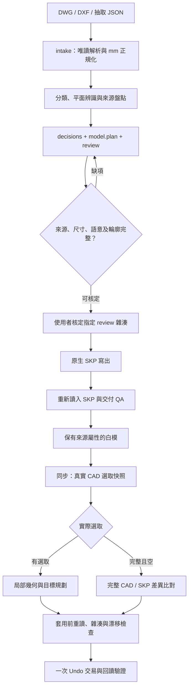

# 架構與資料契約

本專案把來源事實、構件判讀、人類決策、候選幾何及原生實體分開保存。`src/dwg_semantic/` 是核心程式的修改入口；技能發布副本與同步入口共用相同核心及驗證器。

## 兩條工作流程



缺失、截斷或過期的選取快照會停止流程。圖中的整模分支只接受已驗證的真實空選取。

## 程式碼導覽

| 模組／檔案 | 責任 |
|---|---|
| `intake.py`、`adapters/AutoCadExtract.cs` | 唯讀抽取 DWG／DXF、檢查相依來源、正規化單位及實例資料 |
| `classifier.py`、`plan_recognition.py` | 構件分類與逐葉件平面辨識 |
| `plan_geometry.py`、`opening_recognition.py`、`slab_recognition.py` | 材料拓樸、門窗組件及樓板孔域 |
| `modeling.py`、`prepared.py`、`recognized_model.py` | 從決策與候選構造準備模型 |
| `modeling_standard.py`、`fixed_standard_validation.py` | 固定白模規範與檢查 |
| `slabs.py`、`whole_slabs.py`、`whole_slab_qa.py` | 板域、孔洞、降板、整片殼及厚度檢查 |
| `source_accounting.py` | 已建模、已涵蓋、參考、排除與待解來源的差帳 |
| `pipeline.py`、`workflow_io.py` | inspect／review／approve／build／revise 及雜湊契約 |
| `skp_native.py`、`native_revision.py` | SketchUp C API 寫出、讀回及原生修訂 |
| `sync.py`、`live_workflow.py` | 同步 CLI 與已發布的同步動作 |
| `live_repair.py`、`live_cad_geometry.py`、`live_wall_system.py` | 局部目標、來源輪廓與牆系修改 |
| `model_sync.py`、`slab_sync.py` | 整模差異、整片樓板及連帶板底收高 |
| `cad_model.py`、`adapters/ReadActiveCad.ps1` | 目前 CAD 記憶體資料庫的唯讀完整快照 |
| `sketchup_live.py`、`local_snapshot.py` | SketchUp 橋接通訊與世界座標幾何讀取 |
| `skills/dwg-layered-skp/scripts/sketchup/dwg_live_repair_bridge.rb` | SketchUp 端能力檢查、交易、幾何讀取及驗證 |

表中 Python 檔案皆位於 `src/dwg_semantic/`。測試依相同職責拆分，詳細使用方式見[貢獻指南](../CONTRIBUTING.md)。

## 資料與不可變條件

來源物件身分包含來源檔雜湊、原始 handle 與完整實例路徑。同一圖塊放置兩次會產生不同實例身分，不能只依形狀或 handle 合併。來源層、插入層、有效層與構件分類各自保存。

核定綁定來源／參照、正規化資料、規則、分類、決策、候選模型及預覽。`ready_for_confirmation` 只是可供確認；`approval.json` 才保存對該版本的核定。版本改變需重新檢查，建模只接受已核定計畫。

來源盤點與幾何 QA 各自檢查不同問題。某個來源 ID 出現在屬性中，不代表其實際幾何已被材料涵蓋；來源差帳須指出未成模範圍及其明確處理理由。

原生檔驗證會重新讀入實際 SKP，比對 Tag、群組、來源、幾何、座標、高度、材料、封閉性及相關厚度／淨空。候選模型的自我計算不能代替實檔讀回。

## 同步交易

局部模式使用輕量清單與當次世界外框，按範圍取得所需網格。整模模式實際掃描完整 CAD 與 SKP 幾何，再以來源實例關係判斷新增、修改及刪除；未變件保留。

套用前再次讀取 CAD 與 SKP，核對計畫雜湊、模型身分、來源／參照與實際幾何簽章。真正變更在單筆 SketchUp operation 內完成，回讀成功後提交，失敗中止。無差異時不開交易。

同步保存當次 live revision，維持原 `document.json` 與核定資料。同步結果不自動儲存，收據記錄實際交易狀態；收據寫入失敗時須先檢查模型現況。

## 發布與相依

```text
src/dwg_semantic/                         修改及測試入口
  └─ tools/package_skill.py
       ├─ skills/dwg-layered-skp/scripts/runtime/
       ├─ skills/dwg-layered-skp/scripts/runtime-manifest.json
       └─ skills/dwg-skp-sync/scripts/core-dependency.json
```

同步技能是薄入口，不另帶 runtime。啟動器檢查同層核心版本的 manifest 與檔案雜湊，因此兩個技能須成對發布，安裝順序為核心在先、同步在後。不要只更新其中一份啟動器或手動修改相依雜湊。

個案 profile、來源 ID 決策與實測修補留在其案例或外部工作資料。通用程式不依賴本機 `work/` 腳本或客戶圖面才能運作。
